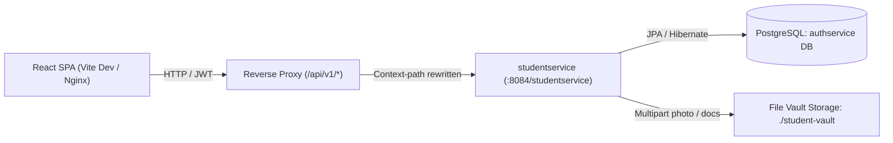
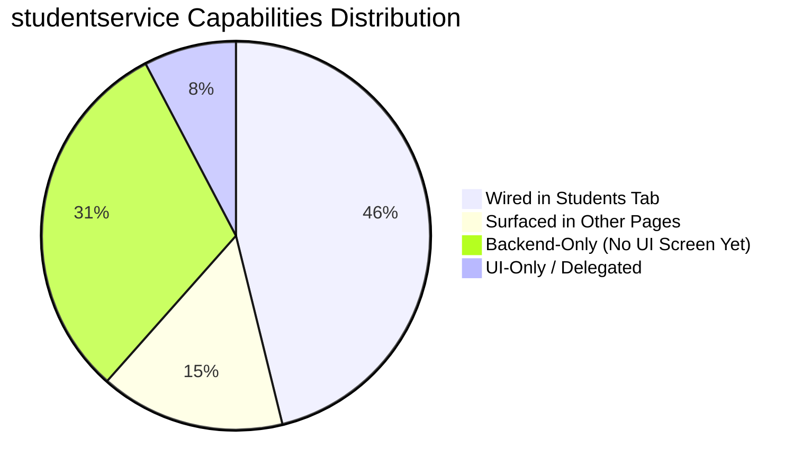
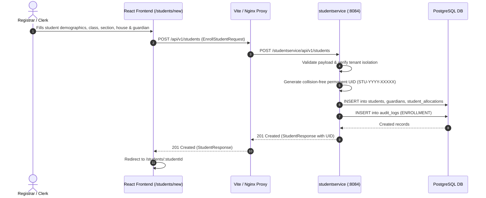

# UI Breakdown & Service Analysis: studentservice (Module 03)

This document provides a comprehensive audit of the **Student Information System (SIS) & Student Lifecycle** microservice (`studentservice`) and its corresponding frontend implementation in the School ERP React web application (`frontend/`).

---

## Metadata & Architecture Reference

| Property | Value |
|---|---|
| **Module** | Module 03 — Student Information System (SIS) & Student Lifecycle |
| **Microservice** | `studentservice` |
| **Base Package** | `com.kvs.student` |
| **Server Port** | `8084` (Test port `18084`) |
| **Servlet Context Path** | `/studentservice` |
| **Reverse Proxy Prefixes** | `/api/v1/students`, `/api/v1/academic`, `/api/v1/attendance`, `/api/v1/alumni` |
| **Primary Frontend Routes** | `/students`, `/students/:studentId`, `/students/new`, `/students/:studentId/edit`, `/attendance` |
| **Key Frontend Files** | [`src/pages/Students.jsx`](file:///c:/dev/schoolerp/frontend/src/pages/Students.jsx), [`src/components/StudentRecords.jsx`](file:///c:/dev/schoolerp/frontend/src/components/StudentRecords.jsx), [`src/components/AttendanceLive.jsx`](file:///c:/dev/schoolerp/frontend/src/components/AttendanceLive.jsx), [`src/components/Promotion.jsx`](file:///c:/dev/schoolerp/frontend/src/components/Promotion.jsx), [`src/api/studentService.js`](file:///c:/dev/schoolerp/frontend/src/api/studentService.js) |
| **User Stories Covered** | `US-03000` through `US-03019` |



---

## 1. UI Screen & Navigation Hierarchy

The frontend surfaces `studentservice` across multiple dedicated routes and cross-module workspaces:

```
├── /students (Students Directory)
│   ├── Tab: All students (Active enrolled roster)
│   ├── Tab: Admissions (Integrated pipeline with admissionservice)
│   ├── Tab: Archived (Transferred & graduated cohort)
│   ├── Action Modal: Promote Class (Batch promotion wizard)
│   └── Metric & Health Cards (Total students, New this year, Incomplete records, Record health)
├── /students/new (Add / Enrol Student)
│   ├── Direct Enrolment Form (POST /api/v1/students)
│   └── Admissions Draft Option (POST /api/v1/admissions/enquiries)
├── /students/:studentId (Student Profile)
│   ├── Header Identity Card (Photo, UID, Name, Status, Roll Number, Message Guardian)
│   ├── Action: Download Record (CSV)
│   ├── Action: ID Card Modal (Barcode & QR verification)
│   ├── Tab: Overview (Unified dashboard of personal, medical, academics, attendance, fees, guardians)
│   ├── Tab: Academics (Federated assessment trend from examservice)
│   ├── Tab: Attendance (Student AM/PM register history & rate)
│   ├── Tab: Fees & payments (Federated ledger from financeservice)
│   ├── Tab: Guardians & emergency contacts (Contacts, phone, emails, parent account linking)
│   ├── Tab: Documents (Student file vault & certificate issuance)
│   │   ├── Action: Issue Certificate (Bonafide / Character)
│   │   └── Action: Issue Transfer Certificate (Dual sign-off TC)
│   └── Tab: Conduct & counseling (Disciplinary incident history & Record incident modal)
├── /students/:studentId/edit (Edit Student)
│   ├── Photo Upload (Multipart vault storage)
│   ├── Medical & Demographics Update (Blood group, alerts, emergency phone)
│   ├── Section & House Allocation (Re-placement)
│   └── Supporting Document Upload (Birth certificate, proofs, care plans)
└── /attendance (Daily Class Attendance Workspace)
    ├── Daily Register Table (AM / PM marks: Present, Late, Excused, Unexcused)
    ├── Class Summary & Open Follow-ups
    ├── Follow-up Dialog (Record contact notes with guardian)
    └── Absence History & CSV Export
```

---

## 2. Screen-by-Screen Visual & Interactive Controls Inventory

### 2.1 Students Directory (`/students`)

* **Page Header & Actions**:
  * `Export list` (Download icon): Exports currently visible table rows (All students, Admissions, or Archived) as a browser-generated CSV file.
  * `Promote class` (Graduation cap icon): Visible to `REGISTRAR`, `SCHOOL_PRINCIPAL`, `SUPER_ADMIN`. Launches `<PromoteClassModal />`.
  * `Add student` (Plus icon): Navigates to `/students/new`.
* **Top Metric Cards**:
  * **Total students**: Formatted count of students on roll, annotated with section count (`Across n class sections`).
  * **New this year**: Total students enrolled since April 1st of the current academic session.
  * **Admission applications**: Count of pending applications awaiting review from `admissionservice`.
  * **Incomplete records**: Count of enrolled records missing primary guardian, emergency contact phone, or blood group.
* **Directory Table & Controls**:
  * **Search Bar**: Real-time substring filter on student full name, UID, or guardian name.
  * **Class Filter**: Select dropdown populated with available classes (`Nursery` through `Class 12`).
  * **Section Filter**: Dynamically populated with sections (`A`, `B`, `C`, etc.).
  * **House Filter**: Filter by house affiliation (`Tagore`, `Raman`, `Shivaji`, `Ashoka`).
  * **Table Columns**:
    * `Student`: Photo/initials avatar, full name, student UID.
    * `Class`: Class name, section, and roll number.
    * `House`: Assigned school house.
    * `Primary guardian`: Full name, relationship, and contact mobile.
    * `Medical`: Amber badge when medical alerts or allergies exist.
    * `Status`: Status pill (`Active`, `Promoted`, `Suspended`, or amber `Needs update`).
    * `Actions`: `View profile` link (`/students/:id`) and `Edit` link (`/students/:id/edit`).
  * **Pagination**: 10 rows per page with page index selector.
* **Bottom Summary Cards**:
  * **Admissions for 2026–2027**: Summary count of incoming applications with button linking to the Admissions tab.
  * **Record health**: Percentage completion calculation with clickable amber pills for each incomplete record to open its edit screen.

---

### 2.2 Add Student (`/students/new`)

* **Enrolment Form Sections**:
  * **Student & admission information**: First name, last name, preferred name, date of birth, gender, admission date, nationality.
  * **Class placement**: Academic year, class (grade), section, house picker (dynamically loaded from `studentservice` academic hierarchy endpoints).
  * **Guardian & emergency contacts**: Primary guardian name, relationship, email, mobile phone, secondary contact, emergency phone, residential address.
  * **Medical declaration**: Blood group (`A+`, `A-`, `B+`, `B-`, `AB+`, `AB-`, `O+`, `O-`), medical conditions, allergies, GP contact.
  * **Required documents checklist**: Live status tracking for Birth Certificate and Transfer Certificate.
* **Form Action Buttons**:
  * `Enrol student` / `Enrol directly`: Calls `POST /api/v1/students` ([US-03000](file:///c:/dev/schoolerp/studentservice/src/main/java/com/kvs/student/controller/StudentController.java#L38-L46)), creates the permanent UID, and redirects to the profile.
  * `Save draft` / `Add student`: Saves as an admission enquiry via `admissionservice` ([US-02001](file:///c:/dev/schoolerp/admissionservice/src/main/java/com/kvs/admission/controller/AdmissionEnquiryController.java#L39-L49)).

---

### 2.3 Student Profile (`/students/:studentId`)

* **Profile Header**:
  * Large round student avatar (rendered from vault photo via `GET /api/v1/students/{id}/photo/file` or initials).
  * Student Name, Student UID, Class-Section, House badge.
  * Status pills (`Active`, `Medical alert`).
  * Secondary meta: Roll number, record creation date.
  * `Message guardian`: Direct mailto link to the primary guardian's registered email.
  * `Download record`: Generates a key-value CSV export of all student fields.
  * `ID card`: Launches `<IdCardModal />` fetching barcode data and QR verification URL (`GET /api/v1/students/{id}/id-card`, [US-03004](file:///c:/dev/schoolerp/studentservice/src/main/java/com/kvs/student/controller/StudentController.java#L128-L135)).
  * `Edit student`: Navigates to `/students/:id/edit`.
* **Sub-Tabs**:
  * **Overview Tab**: Displays aggregate cards for Academic Progress, Attendance summary, Fee balance, Guardians, Personal info, Medical details, and Documents.
  * **Guardians Tab**: Detailed guardian cards with primary contact badge, phone, email, and parent account indicator.
  * **Medical & Wellbeing Card**:
    * Blood group, emergency phone, alerts description.
    * `Update medical information` button (visible to `SCHOOL_NURSE`, `REGISTRAR`, `SUPER_ADMIN`): Opens `<MedicalModal />` calling `PUT /api/v1/students/{id}/medical` ([US-03001](file:///c:/dev/schoolerp/studentservice/src/main/java/com/kvs/student/controller/StudentController.java#L89-L97)).
  * **Documents Tab**:
    * **Stored Files**: Lists files attached to the student record (`GET /api/v1/students/{id}/documents`) with download buttons (`GET /api/v1/students/documents/{docId}/file`).
    * **Upload Document Form**: Document type selector and multipart file picker (`POST /api/v1/students/{id}/documents`).
    * **Certificates Issued**: Table of issued certificates showing number, type, issue date, and signatories.
    * `Issue certificate` button: Modal issuing Bonafide or Character certificates (`POST /api/v1/students/{id}/certificates/bonafide`, [US-03007](file:///c:/dev/schoolerp/studentservice/src/main/java/com/kvs/student/controller/StudentCertificateController.java#L48-L60)).
    * `Issue transfer certificate` button: Modal issuing Transfer Certificates requiring dual sign-off (caller + secondary signatory username), transitioning student status to `TRANSFERRED` (`POST /api/v1/students/{id}/certificates/transfer`, [US-03006](file:///c:/dev/schoolerp/studentservice/src/main/java/com/kvs/student/controller/StudentCertificateController.java#L34-L46)).
  * **Conduct & Counseling Tab**:
    * Disciplinary timeline table showing incident date, category, description, severity badge (`MINOR`, `MODERATE`, `MAJOR`, `SEVERE`), action taken, and counseling notes (`GET /api/v1/students/{id}/disciplinary`, [US-03008](file:///c:/dev/schoolerp/studentservice/src/main/java/com/kvs/student/controller/DisciplinaryIncidentController.java#L46-L56)).
    * `Record incident` button: Opens `<IncidentModal />` calling `POST /api/v1/students/{id}/disciplinary`.
  * **Attendance Tab**: Detailed attendance history and session marks from `studentservice` (`GET /api/v1/attendance/students/{id}`, [US-03018](file:///c:/dev/schoolerp/studentservice/src/main/java/com/kvs/student/controller/AttendanceController.java#L112-L120)).

---

### 2.4 Edit Student (`/students/:studentId/edit`)

* **Photo Upload**: Multi-part upload replacing student avatar (`POST /api/v1/students/{id}/photo/upload`, [StudentFileController](file:///c:/dev/schoolerp/studentservice/src/main/java/com/kvs/student/controller/StudentFileController.java#L36-L42)).
* **Medical Updates**: Update blood group, medical alerts, emergency contact phone (`PUT /api/v1/students/{id}/medical`).
* **Section & House Re-allocation**: Change grade, section, or house placement while preserving roll number (`PUT /api/v1/students/{id}/allocation`, [US-03003](file:///c:/dev/schoolerp/studentservice/src/main/java/com/kvs/student/controller/StudentController.java#L113-L123)).
* **Document Attachment**: Upload birth certificate, proof of address, medical care plan, transfer certificate, or identity cards (up to 10 MB PDF/JPEG/PNG).

---

## 3. End-to-End UI-to-Backend API Mapping Catalog

| UI View / Trigger | Action / Event | Method & Endpoint | Payload / Params | Response DTO | Backend Controller Method | RBAC Roles (`@PreAuthorize`) | Status |
|---|---|---|---|---|---|---|---|
| Directory Table | Load active students | `GET /api/v1/students` | `tenantId`, `branchId` | `List<StudentResponse>` | `StudentController.listStudents` | `REGISTRAR`, `OFFICE_CLERK`, `CLASS_TEACHER`, `SCHOOL_PRINCIPAL`, `SCHOOL_NURSE`, `SUPER_ADMIN` | **Wired** |
| Add Student Form | Enrol student directly | `POST /api/v1/students` | `EnrollStudentRequest` (JSON) | `StudentResponse` | `StudentController.enrollStudent` | `REGISTRAR`, `OFFICE_CLERK`, `SUPER_ADMIN` | **Wired** |
| Profile Screen | Load profile by ID | `GET /api/v1/students/{id}` | Path `studentId` | `StudentResponse` | `StudentController.getStudent` | `REGISTRAR`, `OFFICE_CLERK`, `CLASS_TEACHER`, `SCHOOL_PRINCIPAL`, `SCHOOL_NURSE`, `SUPER_ADMIN` | **Wired** |
| Profile / Edit | Update medical info | `PUT /api/v1/students/{id}/medical` | `UpdateMedicalAlertsRequest` | `StudentResponse` | `StudentController.updateMedicalAlerts` | `SCHOOL_NURSE`, `REGISTRAR`, `SUPER_ADMIN` | **Wired** |
| Edit Student | Reassign class/section/house | `PUT /api/v1/students/{id}/allocation` | `AssignSectionHouseRequest` | `StudentResponse` | `StudentController.assignSectionAndHouse` | `REGISTRAR`, `CLASS_TEACHER`, `HOUSE_MASTER`, `SUPER_ADMIN` | **Wired** |
| Profile Header | View ID Card | `GET /api/v1/students/{id}/id-card` | Path `studentId` | `IdCardResponse` | `StudentController.generateIdCard` | `OFFICE_CLERK`, `REGISTRAR`, `CLASS_TEACHER`, `SUPER_ADMIN` | **Wired** |
| Edit Student | Upload student photo | `POST /api/v1/students/{id}/photo/upload` | Multipart `file` | `StudentResponse` | `StudentFileController.uploadPhoto` | `REGISTRAR`, `OFFICE_CLERK`, `SUPER_ADMIN` | **Wired** |
| Profile Avatar | Stream photo binary | `GET /api/v1/students/{id}/photo/file` | Path `studentId` | `byte[]` | `StudentFileController.photo` | `REGISTRAR`, `OFFICE_CLERK`, `CLASS_TEACHER`, `SCHOOL_PRINCIPAL`, `SCHOOL_NURSE`, `SUPER_ADMIN` | **Wired** |
| Documents Tab | List attached files | `GET /api/v1/students/{id}/documents` | Path `studentId` | `List<StudentDocumentResponse>` | `StudentFileController.listDocuments` | `REGISTRAR`, `OFFICE_CLERK`, `CLASS_TEACHER`, `SCHOOL_PRINCIPAL`, `SCHOOL_NURSE`, `SUPER_ADMIN` | **Wired** |
| Documents Tab | Upload document file | `POST /api/v1/students/{id}/documents` | Multipart `file`, `documentType` | `StudentDocumentResponse` | `StudentFileController.uploadDocument` | `REGISTRAR`, `OFFICE_CLERK`, `SCHOOL_NURSE`, `SUPER_ADMIN` | **Wired** |
| Documents Tab | Download document binary | `GET /api/v1/students/documents/{id}/file` | Path `documentId` | `byte[]` | `StudentFileController.document` | `REGISTRAR`, `OFFICE_CLERK`, `CLASS_TEACHER`, `SCHOOL_PRINCIPAL`, `SCHOOL_NURSE`, `SUPER_ADMIN` | **Wired** |
| Documents Tab | List certificates | `GET /api/v1/students/{id}/certificates` | Path `studentId` | `List<CertificateResponse>` | `StudentCertificateController.listCertificates` | `REGISTRAR`, `OFFICE_CLERK`, `SCHOOL_PRINCIPAL`, `CLASS_TEACHER`, `SUPER_ADMIN` | **Wired** |
| Documents Tab | Issue Bonafide / Character | `POST /api/v1/students/{id}/certificates/bonafide` | `IssueBonafideCertificateRequest` | `CertificateResponse` | `StudentCertificateController.issueBonafideCertificate` | `REGISTRAR`, `SUPER_ADMIN`, `OFFICE_CLERK`, `SCHOOL_PRINCIPAL` | **Wired** |
| Documents Tab | Issue Transfer Certificate | `POST /api/v1/students/{id}/certificates/transfer` | `IssueTransferCertificateRequest` | `CertificateResponse` | `StudentCertificateController.issueTransferCertificate` | `SCHOOL_PRINCIPAL`, `VICE_PRINCIPAL`, `REGISTRAR`, `SUPER_ADMIN` | **Wired** |
| Conduct Tab | List incidents | `GET /api/v1/students/{id}/disciplinary` | Path `studentId` | `List<DisciplinaryIncidentResponse>` | `DisciplinaryIncidentController.listIncidents` | `CLASS_TEACHER`, `SCHOOL_PRINCIPAL`, `VICE_PRINCIPAL`, `SUPER_ADMIN` | **Wired** |
| Conduct Tab | Record incident | `POST /api/v1/students/{id}/disciplinary` | `RecordDisciplinaryIncidentRequest` | `DisciplinaryIncidentResponse` | `DisciplinaryIncidentController.recordIncident` | `CLASS_TEACHER`, `SCHOOL_PRINCIPAL`, `VICE_PRINCIPAL`, `SUPER_ADMIN` | **Wired** |
| Directory Header | Promote class cohort | `POST /api/v1/academic/batch-promotion` | `BatchPromotionRequest` | `BatchPromotionResponse` | `AcademicHierarchyController.batchPromoteStudents` | `REGISTRAR`, `SUPER_ADMIN`, `SCHOOL_PRINCIPAL` | **Wired** |
| Dropdowns | List academic grades | `GET /api/v1/academic/grades` | `tenantId` | `List<Grade>` | `AcademicHierarchyController.listGrades` | Teaching staff, Registrars, Principals, Super Admin | **Wired** |
| Dropdowns | List sections for grade | `GET /api/v1/academic/sections` | `gradeId` | `List<Section>` | `AcademicHierarchyController.listSections` | Teaching staff, Registrars, Principals, Super Admin | **Wired** |
| Dropdowns | List houses | `GET /api/v1/academic/houses` | `tenantId` | `List<House>` | `AcademicHierarchyController.listHouses` | House Master, Registrars, Principals, Teachers | **Wired** |
| Attendance Tab | Student attendance summary | `GET /api/v1/attendance/students/{id}` | `studentId`, `from`, `to` | `StudentAttendanceSummaryResponse` | `AttendanceController.getStudentSummary` | `CLASS_TEACHER`, `ACADEMIC_HEAD`, `VICE_PRINCIPAL`, `SCHOOL_PRINCIPAL`, `REGISTRAR`, `OFFICE_CLERK`, `SUPER_ADMIN` | **Wired** |

---

## 4. Role-Based Access Control (RBAC) Matrix

| Operation / Screen | REGISTRAR | OFFICE_CLERK | CLASS_TEACHER | SCHOOL_PRINCIPAL | VICE_PRINCIPAL | SCHOOL_NURSE | HOUSE_MASTER | SUPER_ADMIN |
|---|:---:|:---:|:---:|:---:|:---:|:---:|:---:|:---:|
| **View Student Directory** | ✅ | ✅ | ✅ | ✅ | ✅ | ✅ *(Read-only)* | ❌ | ✅ |
| **Enrol Student (Direct)** | ✅ | ✅ | ❌ | ❌ | ❌ | ❌ | ❌ | ✅ |
| **View Student Profile** | ✅ | ✅ | ✅ | ✅ | ✅ | ✅ | ❌ | ✅ |
| **Update Medical Info** | ✅ | ❌ | ❌ | ❌ | ❌ | ✅ | ❌ | ✅ |
| **Change Section/House** | ✅ | ❌ | ✅ | ❌ | ❌ | ❌ | ✅ *(House only)* | ✅ |
| **View ID Card** | ✅ | ✅ | ✅ | ❌ | ❌ | ❌ | ❌ | ✅ |
| **Upload Photo** | ✅ | ✅ | ❌ | ❌ | ❌ | ❌ | ❌ | ✅ |
| **Upload Documents** | ✅ | ✅ | ❌ | ❌ | ❌ | ✅ | ❌ | ✅ |
| **Issue Bonafide/Character Cert** | ✅ | ✅ | ❌ | ✅ | ❌ | ❌ | ❌ | ✅ |
| **Issue Transfer Certificate (TC)** | ✅ | ❌ | ❌ | ✅ | ✅ | ❌ | ❌ | ✅ |
| **View Conduct Incidents** | ❌ | ❌ | ✅ | ✅ | ✅ | ❌ | ❌ | ✅ |
| **Record Conduct Incident** | ❌ | ❌ | ✅ | ✅ | ✅ | ❌ | ❌ | ✅ |
| **Promote Class (Batch)** | ✅ | ❌ | ❌ | ✅ | ❌ | ❌ | ❌ | ✅ |

---

## 5. Feature & Gap Analysis



### 5.1 Fully Wired Features
1. **US-03000: Student Enrollment & UID**: Collision-free permanent UID generation, student listing, and detail fetching.
2. **US-03001: Demographics & Medical Alerts**: Blood group recording, medical conditions/allergies tracking, and emergency contacts.
3. **US-03003: Academic Allocation**: Class grade, section, house placement, and roll numbering.
4. **US-03004: Student ID Cards**: Card metadata, barcode payload, and QR verification URL generation.
5. **US-03005: Annual Batch Promotion**: Class cohort promotion advancing eligible passing students to the next grade sequence.
6. **US-03006: Dual-Signoff Transfer Certificates**: Form with primary and secondary administrative authorization; auto-archives student to `TRANSFERRED`.
7. **US-03007: Bonafide & Character Certificates**: Digital certificate generation with tamper-evident verification codes.
8. **US-03008: Disciplinary Incidents & Counseling**: Incident tracking with categories, severity scales, and counseling intervention logs.
9. **US-03014: Photo & File Vault**: Multipart photo uploads, avatar streaming, and document vault management (`StudentFileController`).
10. **US-03018: Roll List Attendance Integration**: Student-level attendance statistics and register history.

### 5.2 Surfaced in Other Workspaces
* **Academic Calendar & Term Dates**: `GET/PUT /api/v1/academic/calendar`, `/sessions/{id}/terms` surfaced in `SettingsCards.jsx` (Admin Settings) and `CalendarPage.jsx`.
* **Daily Class Registers & School Attendance**: `AttendanceController` endpoints surfaced on the dedicated `/attendance` page ([`AttendanceLive.jsx`](file:///c:/dev/schoolerp/frontend/src/components/AttendanceLive.jsx)).
* **School Overview KPIs**: `GET /api/v1/students` and `GET /api/v1/attendance/summary` surfaced on `/` ([`Overview.jsx`](file:///c:/dev/schoolerp/frontend/src/pages/Overview.jsx)).
* **Reports Live**: Weekly attendance trends surfaced on `/reports` ([`ReportsLive.jsx`](file:///c:/dev/schoolerp/frontend/src/components/ReportsLive.jsx)).

### 5.3 Backend-Only Capabilities (Not Yet Surfaced in UI)
The following endpoints exist in `studentservice` controllers but currently have no frontend UI button or modal:

| Story | Endpoint | Purpose | Recommended UI Implementation |
|---|---|---|---|
| **US-03002** | `POST /api/v1/students/{id}/siblings` | Consolidate multi-sibling profiles under a single parent account. | Add a "Link Sibling" button and search modal in the Guardians tab. |
| **US-03009** | `POST /api/v1/alumni/archive` | Explicitly archive graduating students to the permanent alumni registry. | Add an "Archive to Alumni" action in the Archived tab. |
| **US-03010** | `GET /api/v1/students/search` | Multi-criteria demographic search (transport routes, house, status). | Connect the search bar to this endpoint when query complexity warrants server-side filtering. |
| **US-03011** | `PUT /api/v1/students/bulk-contact-update` | Bulk update emergency contact phone and addresses. | Add a "Bulk Update Contacts" table wizard in Directory actions. |
| **US-03012** | `POST/GET /api/v1/students/{id}/activities`<br>`GET /academic/houses/{id}/points` | Log extracurricular participation credits and track house points. | Add an "Activities & House Points" card to the Student Profile. |
| **US-03013** | `POST/GET /api/v1/alumni/credential-verifications` | Historical alumni credential ledger verification. | Add an "Alumni Verification" portal in the Alumni/Archived section. |
| **US-03015** | `POST/PATCH/GET /api/v1/students/{id}/holds` | Place/release administrative holds (fee defaults, document deficiencies). | Add an "Administrative Hold" badge and hold management modal in Profile header. |
| **US-03016** | `POST/GET /api/v1/students/{id}/health-metrics` | Annual health checkup metrics (height, weight, BMI computation). | Add a "Health & Growth" metrics card in the Medical & Wellbeing tab. |
| **US-03017** | `POST/GET /api/v1/students/{id}/electives` | Record language preferences and elective course selections. | Add an "Electives & Languages" card in the Academics tab. |
| **US-03019** | `POST/PATCH/GET /api/v1/students/{id}/section-transfers` | Formal section transfer proposal and academic head approval workflow. | Add a "Request Section Transfer" action with approval workflow in Edit Student. |

---

## 6. Interactive Sequence Workflows

### 6.1 Direct Student Enrollment Workflow (US-03000)



### 6.2 Dual Sign-Off Transfer Certificate Workflow (US-03006)

```mermaid
sequenceDiagram
    autonumber
    actor Principal as School Principal
    participant UI as React Frontend (Documents Tab)
    participant Service as studentservice (:8084)
    participant DB as PostgreSQL DB

    Principal->>UI: Clicks "Issue transfer certificate"
    UI->>UI: Opens modal; enters reason, conduct, & second signatory username
    Principal->>UI: Submits TC request
    UI->>Service: POST /api/v1/students/{id}/certificates/transfer
    Service->>Service: Check roles: Principal / Vice Principal / Registrar
    Service->>Service: Validate initiator != secondSignOffUserId
    Service->>DB: INSERT into student_certificates (TC, dual signatures, QR hash)
    Service->>DB: UPDATE students SET student_status = 'TRANSFERRED'
    Service->>DB: INSERT into audit_logs (TRANSFER_CERTIFICATE)
    Service-->>UI: 201 Created (CertificateResponse)
    UI->>UI: Reloads profile; badge updates to 'Transferred'; student moves to Archived tab
```

---

## 7. Data Models & Entity Summary

| Backend Entity | Database Table | Key Attributes | Corresponding Frontend Component |
|---|---|---|---|
| `Student` | `students` | `studentId` (UUID), `studentUid`, `firstName`, `lastName`, `dateOfBirth`, `gender`, `bloodGroup`, `medicalAlerts`, `emergencyContactPhone`, `studentStatus`, `tenantId`, `branchId` | `StudentsTable`, `StudentProfile`, `valuesOf(s)` |
| `Guardian` | `guardians` | `guardianId`, `studentId`, `fullName`, `relationship`, `mobileNumber`, `email`, `primaryContact` | `guardiansCard`, `DirectoryTable` |
| `StudentAllocation` | `student_allocations` | `allocationId`, `studentId`, `academicYearId`, `gradeId`, `sectionId`, `houseId`, `rollNumber` | `PlacementInfo`, `EditAllocation` |
| `StudentCertificate` | `student_certificates` | `certificateId`, `studentId`, `certificateType`, `certificateNumber`, `issueDate`, `authorizedByUserId`, `secondSignOffUserId`, `verificationQrCode` | `CertificatesCard`, `StudentDocuments` |
| `DisciplinaryIncident` | `disciplinary_incidents` | `incidentId`, `studentId`, `incidentDate`, `severity`, `incidentCategory`, `description`, `actionTaken`, `counselingNotes`, `reportedByUserId` | `ConductCard`, `IncidentModal` |
| `StudentDocument` | `student_documents` | `documentId`, `studentId`, `documentType`, `originalFileName`, `fileSizeBytes`, `contentType`, `vaultPath`, `uploadedBy` | `StudentDocuments`, `StudentAvatar` |
| `Grade` & `Section` | `grades`, `sections` | `gradeId`, `gradeName`, `sequenceOrder`, `sectionId`, `sectionName`, `maxCapacity` | Class & Section filter dropdowns |
| `House` | `houses` | `houseId`, `houseName`, `colorHex` | House filter dropdown, badges |

---

## 8. Verification & Regression Checklist

To verify that the frontend Student tab and `studentservice` are properly synchronized and functional:

1. **Verify Microservice Availability**:
   ```bash
   curl -i http://localhost:8084/studentservice/api/v1/academic/access-rules
   ```
2. **Run Student API Regression Suite**:
   ```bash
   node c:/dev/schoolerp/frontend/scripts/api-regression.mjs --service studentservice
   ```
   *Expected*: All 29 regression tests pass (including tenant isolation, dual sign-off TC validation, and photo vault upload).
3. **Manual UI Screen Walkthrough**:
   * Navigate to `http://localhost:5173/students` with a Registrar or Admin account.
   * Verify total active students count matches the database.
   * Use the search box and filter by Class 7 $\rightarrow$ verify table updates instantly.
   * Click **Add student** $\rightarrow$ fill in required fields $\rightarrow$ click **Enrol student** $\rightarrow$ verify redirect to new profile with generated permanent UID.
   * Open the **Documents** tab $\rightarrow$ issue a Bonafide Certificate $\rightarrow$ verify certificate appears in the issued table.
   * Open the **Conduct** tab with a teacher or principal account $\rightarrow$ record a minor classroom disruption $\rightarrow$ verify timeline updates.
